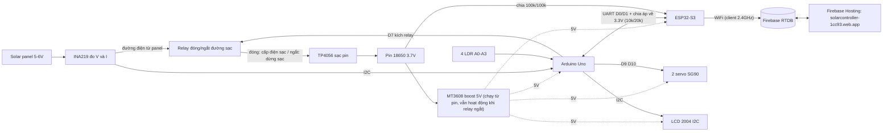
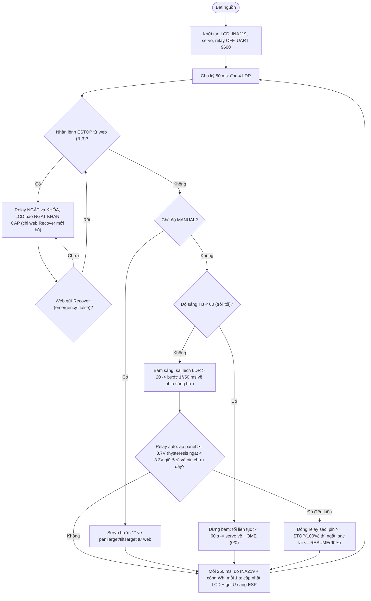

# ☀️ Remote Solar Panel Management

Uno điều khiển và tracking, ESP32-S3 làm cổng WiFi và cloud. LCD 2004 và web cùng hiển thị trạng thái, V, I, P, mức pin.

**Vai trò của relay:** relay đóng/ngắt đường điện từ tấm pin vào TP4056 (panel → INA219 → relay COM–NC → TP4056). Đóng thì pin được sạc, ngắt thì dừng sạc. Khi ngắt, Uno, ESP32, LCD và servo vẫn chạy bằng pin qua MT3608 nên vẫn báo trạng thái và nhận lệnh đóng lại.

**Về web + internet:** ESP32-S3 **không tự host trang lên internet** — nó chỉ là client WiFi, đo/đẩy dữ liệu lên Firebase RTDB và nhận lệnh `/cmd`. Trang public do **Firebase Hosting** phục vụ: `https://solarcontroller-1cc93.web.app/`. Do đó "ESP không lên internet" luôn nghĩa là "ESP chưa nối được WiFi" — xử lý ở mục 3.

[Sơ đồ khối](#1-sơ-đồ-khối) · [Lưu đồ](#2-lưu-đồ-thuật-toán-uno) · [WiFi lần đầu](#3-cấu-hình-wifi-lần-đầu-esp) · [Tài liệu](#4-tài-liệu)

## 1. Sơ đồ khối

Lưu ý đi dây UART: TX Uno 5V → RX ESP 3.3V phải qua chia áp về ~3.3V
(10k/20k như comment trong `solar_gateway.ino`, hoặc 1k/2k — cùng tỉ lệ ~1/3).
Mạch pin ESP: chia 100k/100k vào GPIO4.

## 2. Lưu đồ thuật toán (Uno)

Khớp với `uno_solar_tracker.ino` (không có nút bấm vật lý — mọi lệnh điều khiển
đến từ web qua ESP):

Ghi chú:
- Mất link ESP > 4 s, UNO tự về relay auto an toàn; E-stop chỉ đến từ web.
- Ngưỡng relay (3.7V/3.3V, STOP/RESUME) và giới hạn góc do admin đổi trên
  dashboard → ESP gửi sang UNO bằng gói `K`.

## 3. Cấu hình WiFi lần đầu (ESP)

ESP chưa từng nối WiFi (hoặc sai mật khẩu) sẽ tự mở Access Point riêng:

1. Cấp nguồn ESP (5 V, ≥ 500 mA), mở **Serial Monitor 115200** — thấy dòng
   `[WIFI] Chua co WiFi dang luu -> mo portal config` hoặc
   `[WIFI] Ket loi that bai -> mo portal`.
2. Điện thoại/PC vào WiFi **`SolarTracker-Setup`**, mật khẩu **`12345678`**.
3. Trang **Cau hinh WiFi** tự bật. Nếu không bật, mở tay **http://192.168.4.1/setup**.
4. Nhập SSID (vd `hoangmanh`) + mật khẩu WiFi → **LUU VA KHOI DONG LAI**.
   ESP lưu vào flash rồi tự khởi động lại.
5. Serial thấy `[WIFI] OK, IP=...` là nối được; dashboard đổi trạng thái `ONLINE`.

**Lưu lại vào portal mà vẫn quay lại portal:** mật khẩu sai, hoặc router không hợp.
Nguyên nhân thường gặp:

| Nguyên nhân | Cách sửa |
|---|---|
| Router/SSID chỉ 5 GHz | ESP32-S3 **chỉ hỗ trợ 2.4 GHz** — bật 2.4 GHz hoặc dùng SSID 2.4 GHz |
| Sai mật khẩu WiFi | nhập lại ở portal (sai mật khẩu sẽ tự mở portal lại sau 30 s) |
| SSID bị ẩn | bật phát SSID |
| Router chặn MAC / AP isolation | cho phép thiết bị |
| Nguồn yếu (USB máy tính, MT3608 bị tải) | dùng nguồn 5 V ổn định ≥ 500 mA |

Portal tự khởi động lại sau 10 phút không thao tác; mất WiFi liên tục 1 phút thì portal tự mở lại.
Khi portal đang chạy, UART Uno–ESP vẫn chạy nên LCD vẫn hiển thị % pin.

**Đổi WiFi về sau:** trên dashboard mục "Doi WiFi ESP32" (ghi `/cmd/wifiSsid`,
`/cmd/wifiPass`, `/cmd/wifiTick`, ESP tự lưu + reboot) — chỉ dùng khi ESP còn
online; nếu ESP đã mất WiFi thì vào lại `SolarTracker-Setup` như trên.

## 4. Tài liệu

- [Mã nguồn + README chi tiết (UART protocol, Firebase, deploy, troubleshooting)](SE2044_G1_IOT102t_FinalReport/SourceCode/README.md)
- Report / Slides / Video demo: `SE2044_G1_IOT102t_FinalReport/Document`, `Video Demo`
- Bài nộp LMS: `LMS/`
