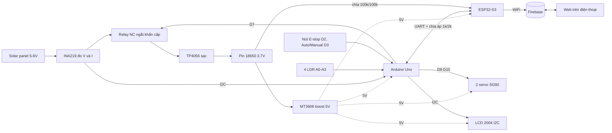

\## firebase config

Project name: SolarController

# ☀️ Remote Solar Panel Management

Uno điều khiển và tracking, ESP32-S3 làm cổng WiFi và cloud. LCD 2004 và web cùng hiển thị trạng thái, V, I, P, mức pin.

## 1. Sơ đồ khối



## 2. Sơ đồ vòng tròn: chu kỳ hoạt động

Vòng lặp 1 giây — Uno + ESP32-S3:

| # | Bước | Nội dung |
|---|------|----------|
| 1 | Cảm nhận | 4 LDR |
| 2 | Quyết định | Auto / Manual / E-stop |
| 3 | Xoay servo | pan + tilt |
| 4 | Đo công suất | INA219: V, I, P |
| 5 | Hiển thị | LCD 2004 |
| 6 | Đẩy lên cloud | ESP32 → Firebase |
| 7 | Nhận lệnh | từ web về Uno |

## 3. Lưu đồ thuật toán (Uno)


## 4. Prompt cho Cirkit Designer (đi dây)

Gửi trước, đợi AI nối dây xong rồi mới sang các prompt mã nguồn.

**Prompt 1: linh kiện và đi dây (Cirkit)**

```text
Answer: the load is the whole system. Power chain: solar panel 5-6 V -> INA219 (high side, panel + line) -> relay (COM -> NC) -> TP4056 -> 3.7 V 18650 -> MT3608 boost set to 5.0 V -> 5 V rail. The rail powers Uno (5V pin), ESP32-S3 (5V pin), 2004 I2C LCD, relay coil, INA219, 2 servos and the LDR dividers. Common GND. The relay switches only the panel + line. Wiring only, no firmware yet.
1. Replace ACS712 with INA219 (I2C 0x40). Add TP4056, 18650, MT3608, a 2nd SG90, a 1000 uF capacitor on the 5 V rail near the servos, a 2nd push button, 4 LDR, four 10k and two 100k resistors. Delete one of the four 200 ohm resistors.
2. Panel chain: panel + -> INA219 VIN+; INA219 VIN- -> relay COM; relay NC -> TP4056 IN+; panel - -> TP4056 IN-; TP4056 B+/B- -> battery; TP4056 OUT+ -> MT3608 VIN+. An energized relay opens COM-NC and cuts the panel. Relay IN -> D7.
3. INA219 and the LCD share Uno A4 (SDA) and A5 (SCL).
4. Servo pan D9, tilt D10, powered from the 5 V rail.
5. Buttons to GND (INPUT_PULLUP): E-stop D2, AUTO/MANUAL D3.
6. LDR: 5 V -> LDR -> node -> 10k -> GND. TL A0, TR A1, BL A2, BR A3.
7. UART: ESP32 GPIO17 (TX) -> Uno D4 (RX). Uno D5 (TX) -> one 200 ohm -> node -> ESP32 GPIO18 (RX); node -> two 200 ohm in series -> GND (about 3.3 V divider).
8. Battery sense: battery + -> 100k -> node -> 100k -> GND; node -> ESP32 GPIO1 (reading x2).
If a pin name differs on the Cirkit board, use an equivalent free GPIO and tell me which. Finish with a connection table and flag every part that has no simulation model.
```

## 5. Prompt sinh mã nguồn

Prompt 2 và 3 gửi tiếp trong cùng cuộc trò chuyện Cirkit. Prompt 4 dùng ở Claude hoặc công cụ khác.

**Prompt 2: firmware Uno**

```text
Write the Uno firmware (Adafruit_INA219, LiquidCrystal_I2C 20x4 at 0x27, Servo, SoftwareSerial 9600). Pins: D2 E-stop, D3 mode button, D4 RX, D5 TX, D7 relay, D9 pan, D10 tilt, A0-A3 LDR TL TR BL BR. Put all thresholds in #defines.
States: TRACKING, WAITING, MANUAL, ESTOP.
Every 1 s: read INA219 (average 10 samples), V, I in mA, P = V x I, Wh += P / 3600.
WAITING: LDR average below DARK_THRESHOLD for 30 s -> servos to HOME_PAN / HOME_TILT (panel faces east), then detach the servos. Check light every 10 s; above LIGHT_THRESHOLD (hysteresis) for 10 s -> TRACKING.
TRACKING stage 1 (coarse): compare top (TL+TR) vs bottom (BL+BR) and left (TL+BL) vs right (TR+BR); if the error exceeds LDR_TOLERANCE, move that servo 1 deg toward the brighter side every 50 ms.
Stage 2 (fine): after both errors stay inside the tolerance for 5 s, every 2 s perturb one axis by 2 deg (alternate pan and tilt); keep the direction if P rose by more than 1 percent, otherwise reverse. Limit to +/- 10 deg around the LDR-aligned angle. If an LDR error exceeds the tolerance again, return to stage 1.
MANUAL: the D3 button or an ESP32 command toggles the mode; angles come only from ESP32 commands.
ESTOP (top priority in every state): D2 or an ESP32 command sets D7 to cut the panel, servos stop, LCD shows EMERGENCY STOP; pressing again or a command resumes the previous mode.
LCD 20x4 every 1 s: L1 state (SUN TRACKING / WAITING FOR SUNRISE / MANUAL MODE / EMERGENCY STOP); L2 V and I; L3 P and Wh; L4 battery percent (3.0 V = 0, 4.2 V = 100), CHG or IDLE (I below 5 mA), Net OK or OFF.
UART: Uno -> ESP32 every 1 s: T,state,V,I_mA,P_W,Wh,pan,tilt,relay. ESP32 -> Uno: B,battV (every 5 s); N,0|1; C,MODE,AUTO|MANUAL; C,PAN,deg; C,TILT,deg; C,ESTOP,1|0.
SIM_MODE 1: if the INA219 or LDRs cannot be simulated, generate data from a simulated sun (sunAz, sunEl) with a day/night cycle of about 5 minutes: P = 1 W x max(0,cos(panErr)) x max(0,cos(tiltErr)) x daylight, V 5-6 V, I = P / V; LDR values from the same errors, near 0 at night.
```

**Prompt 3: firmware ESP32-S3 + Firebase**

```text
Write the ESP32-S3 firmware (Arduino framework, WiFi, HTTPClient, WiFiClientSecure, no cloud library). UART1: RX GPIO18, TX GPIO17, 9600 baud, same line protocol as the Uno. Every 5 s read the battery on GPIO1 (ADC1, average 16 samples, multiply by 2) and send B,V to the Uno. Parse the T lines into the latest telemetry.
Cloud = Firebase Realtime Database over REST (placeholders WIFI_SSID, WIFI_PASS, FIREBASE_URL, FIREBASE_AUTH):
- PUT /telemetry.json every 2 s: {state,v,i_ma,p_w,wh,bat_v,bat_pct,pan,tilt,relay,ts}
- POST /history.json every 10 s: {ts,p_w,v,i_ma}
- GET /commands.json every 2 s: {mode,pan,tilt,estop}; forward every change to the Uno as C lines.
Send N,1 after a successful request and N,0 after a failure. Reconnect WiFi automatically. Use NTP for ts.
#define CLOUD_ENABLED 0 for the simulator: skip WiFi, only print the requests to Serial, still run UART and the battery part. #define SIM_BATTERY generates a slowly changing battery voltage when the ADC is not simulated.
```

**Prompt 4: trang web dashboard**

```text
Write one single-file HTML page (no framework) as a dashboard for the Firebase Realtime Database REST API (const FIREBASE_URL placeholder). Poll /telemetry.json every 2 s and /history.json every 10 s (last 60 points).
Show: state badge (SUN TRACKING / WAITING FOR SUNRISE / MANUAL / EMERGENCY), V, I, P, energy in Wh, battery percent bar, pan and tilt angles, last update time, and an offline warning if ts is older than 15 s. Draw a line chart of power over time with a plain canvas.
Controls, written with PATCH to /commands.json: AUTO/MANUAL switch, pan and tilt sliders 0-180 (enabled only in MANUAL), a large red EMERGENCY STOP button with a confirm dialog, and a RESET button.
Mobile first, dark mode, Vietnamese labels.
```

> Trang web ở prompt 4 phải chạy trên Firebase Hosting, GitHub Pages hoặc mở file trực tiếp trên máy. Trang do Claude đăng bị chặn kết nối ra ngoài nên không đọc được Firebase.

## 6. Checklist dự án

Tiến độ: tự lưu trên trình duyệt ở bản HTML gốc.

### 1. Mua sắm (đã có: TP4056, MT3608, pin, ESP32, Uno, 1 servo, panel, 4 LDR)

- [ ] Module INA219 (MCU-219)
- [ ] Module relay 1 kênh 5V có opto
- [ ] LCD 2004 có sẵn module I2C
- [ ] Servo SG90 thứ 2 và giá đỡ pan-tilt
- [ ] 2 nút nhấn
- [ ] Điện trở: 4 con 10kΩ, 2 con 100kΩ, 1 con 1kΩ, 1 con 2kΩ
- [ ] Tụ 1000µF, breadboard, dây Dupont, đế pin 18650, công tắc gạt
- [ ] Đồng hồ vạn năng, mỏ hàn, thiếc, dây điện

### 2. Xác nhận thông số

- [ ] Loại ESP32: S3 hay WROOM-32 (WROOM thì đổi GPIO1 sang GPIO34)
- [ ] TP4056 có chip bảo vệ DW01 hay không
- [ ] Tấm pin: điện áp hở mạch không quá 8V, đủ nhẹ cho SG90
- [ ] Địa chỉ I2C của LCD (0x27 hoặc 0x3F) bằng I2C scanner

### 3. Mô phỏng trên Cirkit

- [ ] Gửi prompt 1, kiểm tra bảng kết nối AI trả về
- [ ] Gửi prompt 2, chạy SIM_MODE
- [ ] Gửi prompt 3 với CLOUD_ENABLED 0
- [ ] Kiểm tra: LCD, tracking, WAITING FOR SUNRISE, E-stop

### 4. Cloud và web

- [ ] Tạo dự án Firebase, bật Realtime Database, lấy FIREBASE_URL
- [ ] Điền WIFI_SSID, WIFI_PASS, FIREBASE_URL, FIREBASE_AUTH, đặt CLOUD_ENABLED 1
- [ ] Sinh trang web bằng prompt 4 và đưa lên Firebase Hosting hoặc GitHub Pages
- [ ] Mở từ điện thoại, kiểm tra dữ liệu và gửi lệnh hai chiều

### 5. Lắp ráp và test từng khối

- [ ] Chỉnh MT3608 đúng 5,0V bằng đồng hồ trước khi cắm tải
- [ ] Test TP4056 + pin + MT3608 ra rail 5V
- [ ] Test INA219 (thấy 0x40, đọc được V và I)
- [ ] Test LCD 2004
- [ ] Test 2 servo (cấp từ rail 5V, có tụ 1000µF)
- [ ] Test 4 LDR (đọc A0 đến A3)
- [ ] Test relay NC cắt dây (+) của panel
- [ ] Test UART Uno và ESP32 qua cầu chia áp 1k/2k
- [ ] Test đo pin ở GPIO1 qua cầu chia 100k/100k
- [ ] Test cloud hai chiều với phần cứng thật

### 6. Nghiệm thu

- [ ] Chạy ngoài nắng thật, so sánh công suất có và không tracking
- [ ] E-stop từ nút và từ web đều cắt được panel
- [ ] Che LDR để thấy WAITING FOR SUNRISE rồi chiếu sáng để quay lại tracking
- [ ] Không cắm USB khi rail 5V đang cấp điện
- [ ] Chụp ảnh, quay video, xuất đồ thị công suất cho báo cáo

Project ID: solarcontroller-1cc93

Project number: 325525934406

realtimeDB: https://solarcontroller-1cc93-default-rtdb.asia-southeast1.firebasedatabase.app

Domains: solarcontroller-1cc93.web.app Default | solarcontroller-1cc93.firebaseapp.com Default


