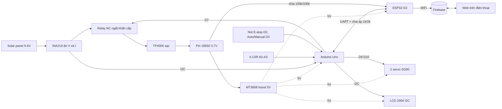
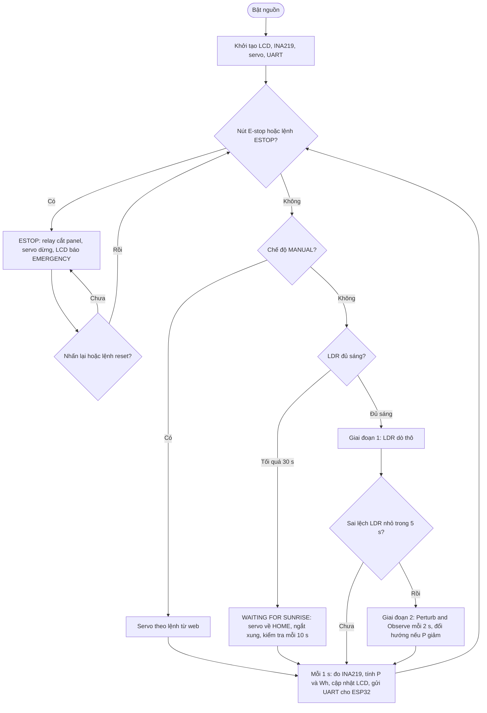

# ☀️ Remote Solar Panel Management

Uno điều khiển và tracking, ESP32-S3 làm cổng WiFi và cloud. LCD 2004 và web cùng hiển thị trạng thái, V, I, P, mức pin.

**Đề bài:** đọc V và I của tấm pin · Auto xoay panel để công suất cao nhất · Manual ngắt đường điện khi khẩn cấp · hiển thị công suất theo thời gian trên LCD và web/app (servo motor).

---

## ⚡ Rush: đọc phần này trước

### Trạng thái hiện tại

| Hạng mục | Trạng thái |
|---|---|
| Thiết kế, sơ đồ, lưu đồ | ✅ xong (xem mục 5) |
| Mạch Cirkit (project cũ) | ✅ bảng 23 net khớp thiết kế · ⬜ còn đặt giá trị điện trở bằng tay |
| Firmware Uno `solar_uno.ino` | ✅ viết xong, đã chạy thử logic trên máy tính với mặt trời giả |
| Firmware ESP32-S3 `solar_esp32.ino` | ✅ viết xong, ⬜ chưa chạy thử trong Cirkit hoặc trên board thật |
| Firebase project | ✅ đã tạo (mục 1) · ⬜ rules · ⬜ Hosting |
| Web dashboard | ⬜ chưa làm (prompt ở mục 6) |
| Linh kiện còn thiếu | ⬜ chưa đặt |
| Lắp mạch thật | ⬜ |

### Đường găng (làm theo thứ tự này, các nhánh chạy song song)

1. **Đặt hàng ngay**, vì giao hàng là thời gian chờ lâu nhất. Danh sách ở checklist 1. Gọi shop xác nhận tồn kho trước khi đặt.
2. **Nhánh B, mô phỏng** (trong lúc chờ hàng): mở project Cirkit cũ → đặt giá trị điện trở bằng tay → dán 2 file `.ino` vào Uno và ESP32 → chạy với `SIM_MODE 1`. **Không dùng Cirkit AI để xây mạch** (đã thử, không xong và tốn lượt).
3. **Nhánh C, cloud và web** (cũng trong lúc chờ): đặt rules Firebase (mục 1) → sinh web bằng prompt ở mục 6 → `firebase deploy` → thử bằng lệnh `curl` mục 2, **không cần phần cứng**.
4. **Khi hàng về:** lắp theo 6 bước ở checklist 5, mỗi bước test xong mới sang bước sau, rồi đổi cấu hình sang mạch thật (mục 3).
5. **Nghiệm thu** ngoài nắng (checklist 6).

### Nếu hết giờ thì bỏ (không đụng vào yêu cầu đề bài)

- Wh tích lũy và % pin trên web (LCD vẫn giữ).
- Giá đỡ pan-tilt mua sẵn: tự làm bằng nhựa hoặc bìa cứng.
- Hàn dây: dùng breadboard và dây Dupont.
- Trời không nắng lúc demo: chạy `SIM_MODE 1`, vì code đã giả lập mặt trời với chu kỳ ngày đêm 5 phút.

---

## 1. Firebase config

| Mục | Giá trị |
|---|---|
| Project name | SolarController |
| Project ID | `solarcontroller-1cc93` |
| Project number | `325525934406` |
| Realtime Database URL | `https://solarcontroller-1cc93-default-rtdb.asia-southeast1.firebasedatabase.app` |
| Hosting | `https://solarcontroller-1cc93.web.app` · `https://solarcontroller-1cc93.firebaseapp.com` |

**Dữ liệu ESP32 ghi và web đọc** (REST, đã khớp `solar_esp32.ino`):

| Đường dẫn | Ai ghi | Nội dung |
|---|---|---|
| `/telemetry.json` | ESP32, mỗi 2 s (PUT) | `state` (`TRACK`/`WAIT`/`MANUAL`/`ESTOP`), `v`, `i_ma`, `p_w`, `wh`, `bat_v`, `bat_pct`, `pan`, `tilt`, `relay` (1 = đã cắt panel), `ts` (giây epoch UTC, bằng 0 khi chưa đồng bộ NTP) |
| `/history.json` | ESP32, mỗi 10 s (POST) | `ts`, `p_w`, `v`, `i_ma` |
| `/commands.json` | Web (PATCH), ESP32 đọc mỗi 2 s | `mode` (`AUTO`/`MANUAL`), `pan`, `tilt` (0 đến 180), `estop` (`true`/`false`) |

ESP32 tự reset `/commands.json` về mặc định (`AUTO`, 90, 90, `false`) ngay lần đọc đầu sau khi khởi động.

**Rules để demo** (Console → Realtime Database → Rules):

```json
{
  "rules": {
    ".read": true,
    ".write": true
  }
}
```

> ⚠️ Rules này mở hoàn toàn: ai biết URL cũng ghi được, kể cả lệnh `estop`. Chỉ dùng để demo, sau đó đóng lại. Không đưa `FIREBASE_AUTH`, mật khẩu WiFi hay database secret vào README hoặc GitHub.

**Deploy web lên Hosting:**

```bash
npm i -g firebase-tools
firebase login
firebase init hosting      # chọn project solarcontroller-1cc93, public directory: web, single-page app: No
# đặt file web/index.html rồi:
firebase deploy --only hosting
```

Dọn lịch sử trước buổi demo: `curl -X DELETE "$DB/history.json"`.

---

## 2. Test cloud và web không cần phần cứng

```bash
DB="https://solarcontroller-1cc93-default-rtdb.asia-southeast1.firebasedatabase.app"

# giả lập ESP32 đẩy số liệu
curl -X PUT -d '{"state":"TRACK","v":5.2,"i_ma":120,"p_w":0.62,"wh":0.5,"bat_v":3.9,"bat_pct":75,"pan":90,"tilt":60,"relay":0,"ts":0}' "$DB/telemetry.json"

# giả lập vài điểm lịch sử
curl -X POST -d '{"ts":0,"p_w":0.55,"v":5.1,"i_ma":108}' "$DB/history.json"

# xem lệnh mà web đã gửi
curl "$DB/commands.json"
```

---

## 3. Cấu hình code và chuyển sang mạch thật

| Cờ | Mô phỏng | Mạch thật |
|---|---|---|
| `SIM_MODE` (Uno) | `1` | `0` (cần thư viện Adafruit_INA219) |
| `HAS_RELAY` (Uno) | `1` | `1` khi có relay, `0` khi chưa có |
| `RELAY_ACTIVE_HIGH` (Uno) | `1` | `1` nếu jumper module ở HIGH, `0` nếu ở LOW |
| `LDR_INVERT` (Uno) | `1` | kiểm tra: che LDR mà giá trị tăng thì giữ `1` |
| `CLOUD_ENABLED` (ESP32) | `0` | `1`, điền `WIFI_SSID`, `WIFI_PASS` (`FIREBASE_URL` đã điền sẵn trong file) |
| `SIM_BATTERY` (ESP32) | `1` | `0` |
| `PIN_BAT` (ESP32) | `1` | `1` với ESP32-S3, **`34` với WROOM-32** |

**Bảng chân:**

| Chân Uno | Nối với |
|---|---|
| D2 / D3 | nút E-stop / nút MODE (một chân xuống GND, `INPUT_PULLUP`) |
| D4 (RX) | ESP32 GPIO17 (TX) |
| D5 (TX) | cầu chia áp 1kΩ trên, 2kΩ dưới → ESP32 GPIO18 (RX) |
| D7 | relay IN |
| D9 / D10 | servo pan / servo tilt |
| A0 / A1 / A2 / A3 | LDR TL / TR / BL / BR (chân AO) |
| A4 / A5 | SDA / SCL chung cho INA219 và LCD (0x27) |

ESP32 đo pin: pin (+) → 100kΩ → nút giữa → 100kΩ → GND, nút giữa → GPIO1 (kết quả nhân 2).

**Giao thức UART 9600:**
- Uno → ESP32 mỗi 1 s: `T,state,V,I_mA,P_W,Wh,pan,tilt,relay`
- ESP32 → Uno: `B,battV` (5 s) · `N,0|1` · `C,MODE,AUTO|MANUAL` · `C,PAN,deg` · `C,TILT,deg` · `C,ESTOP,1|0`
- Test lệnh nhanh: gõ `C,MODE,MANUAL` hoặc `C,ESTOP,1` vào serial monitor của ESP32, nó chuyển sang Uno.

**An toàn khi lắp:** chỉnh MT3608 đúng 5,0V trước khi cắm tải · pin (−) của TP4056 bản có bảo vệ chỉ nối vào B− · rút dây 5V của Uno khỏi rail khi nạp code qua USB.

---

## 4. Cấu trúc file

```text
solar_uno.ino       firmware Uno (tracking LDR + P&O, E-stop, LCD, UART)
solar_esp32.ino     firmware ESP32-S3 (UART, đo pin, Firebase REST)
web/index.html      dashboard (sinh bằng prompt mục 6, deploy lên Hosting)
README.md
```

---

## 5. Tài liệu thiết kế

### Sơ đồ khối



### Vòng lặp 1 giây (Uno + ESP32-S3)

| # | Bước | Nội dung |
|---|------|----------|
| 1 | Cảm nhận | 4 LDR |
| 2 | Quyết định | Auto / Manual / E-stop |
| 3 | Xoay servo | pan + tilt |
| 4 | Đo công suất | INA219: V, I, P |
| 5 | Hiển thị | LCD 2004 |
| 6 | Đẩy lên cloud | ESP32 → Firebase |
| 7 | Nhận lệnh | từ web về Uno |

### Lưu đồ thuật toán (Uno)



---

## 6. Prompt sinh web dashboard

Firmware Uno và ESP32 đã có sẵn trong repo, nên các prompt Cirkit và firmware cũ đã bỏ. Prompt này dùng ở Claude hoặc công cụ khác, đã điền sẵn URL và cấu trúc dữ liệu thật.

```text
Write one single-file HTML page (no framework, no build step) as a mobile-first dashboard for a solar tracker, reading and writing the Firebase Realtime Database over REST.
const FIREBASE_URL = "https://solarcontroller-1cc93-default-rtdb.asia-southeast1.firebasedatabase.app";

Data (all JSON, append .json to the path):
- GET /telemetry.json every 2 s -> {state, v, i_ma, p_w, wh, bat_v, bat_pct, pan, tilt, relay, ts}
  state is one of TRACK, WAIT, MANUAL, ESTOP. relay = 1 means the panel line is cut. ts is epoch seconds UTC; if ts is 0 the device clock is not synced yet, so skip the offline check.
- GET /history.json?orderBy="$key"&limitToLast=60 every 10 s -> object of {ts, p_w, v, i_ma}; sort by key and draw the line chart of p_w over time with a plain canvas (no library). If ts is 0 use the sample index as the x axis.
- PATCH /commands.json with any of {mode: "AUTO"|"MANUAL", pan: 0-180, tilt: 0-180, estop: true|false}.

Show: a state badge (TRACK = SUN TRACKING, WAIT = WAITING FOR SUNRISE, MANUAL = MANUAL MODE, ESTOP = EMERGENCY STOP in red), V, I (mA), P (W), energy Wh, a battery percent bar with bat_v, pan and tilt angles, a relay badge (PANEL CONNECTED / PANEL CUT), the last update time, and an OFFLINE warning when ts is older than 15 s.
Controls: AUTO/MANUAL switch; pan and tilt sliders (enabled only in MANUAL, send on release, not on every move); a large red EMERGENCY STOP button with a confirm dialog (sends estop true); a RESET button (sends estop false).
Handle fetch errors with a visible banner and keep retrying. Dark mode, Vietnamese labels, works from file:// and from Firebase Hosting.
```

---

## 7. Checklist dự án

### 1. Mua sắm (đã có: TP4056, MT3608, pin, ESP32, Uno, 1 servo, panel, 4 LDR)

- [ ] Module relay 1 kênh 5V có opto: [kích H/L bằng jumper, 19.000₫](https://icdayroi.com/module-1-relay-5v-voi-opto-cach-ly-kich-h-l) hoặc [kích mức cao, 15.000₫](https://icdayroi.com/module-1-relay-5v-kich-muc-cao) (giá lúc kiểm tra, xác nhận tồn kho với shop)
- [ ] Module INA219 (MCU-219)
- [ ] LCD 2004 có sẵn module I2C
- [ ] Servo SG90 thứ 2 và giá đỡ pan-tilt
- [ ] 2 nút nhấn
- [ ] Điện trở: 2 con 100kΩ, 1 con 1kΩ, 1 con 2kΩ (thêm 4 con 10kΩ **chỉ khi** LDR là loại rời, không phải module)
- [ ] Tụ 1000µF, breadboard, dây Dupont, đế pin 18650, công tắc gạt
- [ ] Đồng hồ vạn năng, mỏ hàn, thiếc, dây điện

### 2. Xác nhận thông số

- [ ] Loại ESP32: S3 hay WROOM-32 (WROOM thì `PIN_BAT` = 34)
- [ ] TP4056 có chip bảo vệ DW01 hay không
- [ ] Tấm pin: điện áp hở mạch không quá 8V, đủ nhẹ cho SG90
- [ ] Địa chỉ I2C của LCD (0x27 hoặc 0x3F) bằng I2C scanner
- [ ] 4 LDR là module (có AO/DO) hay LDR rời

### 3. Mô phỏng trên Cirkit

- [x] Đi dây project cũ: bảng 23 net khớp thiết kế (GND chung, tụ 1000µF, EN của MT3608 đã có)
- [ ] Đặt giá trị điện trở bằng tay: 3 con 200Ω, 2 con 100kΩ
- [ ] Dán `solar_uno.ino` vào Uno, `solar_esp32.ino` vào ESP32-S3, chạy `SIM_MODE 1`
- [ ] Kiểm tra: LCD, tracking, WAITING FOR SUNRISE, E-stop

### 4. Cloud và web

- [x] Tạo dự án Firebase và Realtime Database
- [ ] Đặt rules (mục 1)
- [ ] Sinh `web/index.html` bằng prompt mục 6, test bằng `curl` (mục 2)
- [ ] `firebase deploy --only hosting`, mở `solarcontroller-1cc93.web.app` từ điện thoại
- [ ] Điền `WIFI_SSID`, `WIFI_PASS`, đặt `CLOUD_ENABLED 1`, kiểm tra dữ liệu và lệnh hai chiều

### 5. Lắp ráp và test từng khối

- [ ] Chỉnh MT3608 đúng 5,0V bằng đồng hồ trước khi cắm tải
- [ ] Test TP4056 + pin + MT3608 ra rail 5V
- [ ] Test INA219 (thấy 0x40, đọc được V và I)
- [ ] Test LCD 2004
- [ ] Test 2 servo (cấp từ rail 5V, có tụ 1000µF)
- [ ] Test 4 LDR (đọc A0 đến A3, kiểm tra `LDR_INVERT`)
- [ ] Test relay: COM nối INA219 VIN−, NC sang TP4056 IN+, NO để trống; D7 lên mức kích thì panel bị cắt
- [ ] Test UART Uno và ESP32 qua cầu chia áp 1k/2k
- [ ] Test đo pin ở GPIO1 qua cầu chia 100k/100k
- [ ] Test cloud hai chiều với phần cứng thật

### 6. Nghiệm thu

- [ ] Chạy ngoài nắng thật, so sánh công suất có và không tracking
- [ ] E-stop từ nút và từ web đều cắt được panel
- [ ] Che LDR để thấy WAITING FOR SUNRISE rồi chiếu sáng để quay lại tracking
- [ ] Không cắm USB khi rail 5V đang cấp điện
- [ ] Chụp ảnh, quay video, xuất đồ thị công suất cho báo cáo
